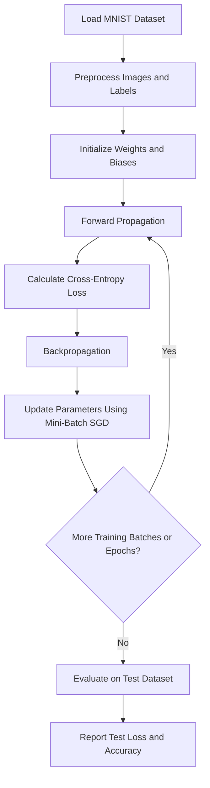

# Multilayer Perceptron (MLP) From Scratch Using MNIST

> **A neural-network implementation built with NumPy to understand the internal working of a Multilayer Perceptron — from forward propagation and backpropagation to training and evaluation.**


## 🚀 Interactive Project Visualization

Explore the animated neural network architecture and project overview.

<p align="center">
  <a href="https://YOUR-USERNAME.github.io/YOUR-REPOSITORY/">
    
  </a>
</p>

**The interactive visualization includes:**
- Animated neural network connections
- Input, hidden and output layers
- Data flow visualization
- MLP architecture overview

[🌐 View Animated Project](https://mlp-project-mu.vercel.app/)

## Project Information

| Field | Details |
|---|---|
| Project title | Multilayer Perceptron (MLP) From Scratch Using MNIST |
| Project type | Academic / Machine Learning |
| Dataset | MNIST handwritten digits |
| Main implementation | Python and NumPy |
| Comparison implementation | PyTorch (separate experiment) |
| Network architecture | 784 → 128 → 64 → 10 |

---

## 1. Project Overview

This project implements a **Multilayer Perceptron (MLP)** neural network from scratch using Python and NumPy. The model is trained on the MNIST handwritten-digit dataset to classify grayscale images into one of ten digit classes, from 0 to 9.

The main purpose is educational: instead of relying on a machine-learning framework to construct and train the primary model, the project manually implements the important neural-network operations. These include dense layers, activation functions, forward propagation, loss calculation, backpropagation, gradient calculation, and mini-batch Stochastic Gradient Descent (SGD).

A separate PyTorch implementation is used as a reference comparison. It is not used to implement or train the NumPy model.

## 2. Problem Statement

Handwritten digit recognition is a classification problem in which a computer must identify the digit represented by an image. Handwritten digits can differ in shape, size, stroke thickness, and writing style, which makes classification more challenging than matching an image against a fixed template.

Machine-learning libraries provide ready-made layers, loss functions, and automatic differentiation. Although these tools are useful, using them without understanding their internal operations can make it difficult for a student to understand how a neural network learns.

**The problem addressed by this project is to build and train a handwritten-digit classifier while implementing the fundamental operations of an MLP manually, using NumPy, and validating the correctness of its gradients.**

## 3. Proposed Solution

The project uses a fully connected feed-forward neural network with two hidden layers.

1. Load the MNIST images and labels.
2. Flatten each 28 × 28 grayscale image into a vector of 784 values.
3. Normalize pixel values to the range 0 to 1.
4. Pass the input through three dense layers.
5. Apply ReLU activation to the two hidden layers.
6. Calculate class probabilities using Softmax.
7. Calculate the classification loss using cross-entropy.
8. Compute gradients through manual backpropagation.
9. Update weights and biases using mini-batch SGD.
10. Evaluate the trained model on the test dataset.

The project also performs numerical gradient checking on a small synthetic dataset to compare analytical gradients from backpropagation with numerical approximations.

## 4. Project Objectives

- Understand the structure and working of a Multilayer Perceptron.
- Implement fully connected (dense) layers using NumPy.
- Implement forward propagation and backward propagation manually.
- Understand and use the ReLU activation function.
- Implement numerically stable Softmax and cross-entropy calculations.
- Train the network using mini-batch Stochastic Gradient Descent.
- Load and preprocess the MNIST dataset.
- Verify gradients using numerical gradient checking.
- Evaluate classification performance on unseen test images.
- Compare the NumPy implementation with a separate PyTorch model.

## 5. Dataset: MNIST

MNIST is a handwritten-digit image dataset containing grayscale images of digits from 0 to 9.

| Property | Description |
|---|---|
| Image dimensions | 28 × 28 pixels |
| Image channels | 1 (grayscale) |
| Input features after flattening | 784 |
| Number of classes | 10 |
| Class labels | 0, 1, 2, 3, 4, 5, 6, 7, 8, 9 |
| Training set | 60,000 images |
| Test set | 10,000 images |

### Preprocessing

- Convert each image into a one-dimensional vector containing 784 pixel values.
- Convert pixel values from the unsigned 8-bit range (0–255) to floating-point values.
- Normalize pixels by dividing by 255.
- Keep labels as integer class values from 0 to 9.

The NumPy data loader reads the compressed MNIST IDX files directly. Therefore, the core NumPy implementation does not require a machine-learning dataset library to load MNIST.

## 6. System Architecture

### 6.1 Neural Network Architecture

The model contains one input layer, two hidden layers, and one output layer.

```text
                 MNIST INPUT IMAGE
                    28 × 28
                       |
                       v
              Flatten: 784 features
                       |
                       v
              +------------------+
              |  Input: 784      |
              +------------------+
                       |
                       v
              +------------------+
              | Dense Layer 1    |
              | 784 → 128        |
              | ReLU             |
              +------------------+
                       |
                       v
              +------------------+
              | Dense Layer 2    |
              | 128 → 64         |
              | ReLU             |
              +------------------+
                       |
                       v
              +------------------+
              | Output Layer     |
              | 64 → 10          |
              | Softmax          |
              +------------------+
                       |
                       v
              Predicted digit: 0–9
```

### 6.2 Layer Description

| Layer | Input size | Output size | Operation |
|---|---:|---:|---|
| Input | — | 784 | Flattened image |
| Dense 1 | 784 | 128 | Fully connected + ReLU |
| Dense 2 | 128 | 64 | Fully connected + ReLU |
| Output | 64 | 10 | Fully connected + Softmax |

The dense layer computes:

\[
Z = XW + b
\]

where `X` is the input, `W` is the weight matrix, and `b` is the bias vector.

### 6.3 Training Workflow



## 7. Important Concepts Implemented

### 7.1 Dense Layer

A dense layer connects every input feature to every neuron in the next layer. It performs a matrix multiplication followed by the addition of a bias vector.

\[
Z = XW + b
\]

Weights are initialized using He initialization because the hidden layers use ReLU activation.

### 7.2 Forward Propagation

Forward propagation passes input data through the network to generate predictions.

- Dense transformation
- ReLU activation
- Dense transformation
- ReLU activation
- Output logits
- Softmax probabilities

### 7.3 ReLU Activation

ReLU introduces non-linearity into the network.

\[
ReLU(z) = \max(0,z)
\]

It returns zero for negative inputs and keeps positive inputs unchanged.

### 7.4 Softmax and Cross-Entropy

Softmax converts output logits into class probabilities. The probabilities for each image sum to approximately one.

Cross-entropy measures the difference between the predicted class probabilities and the correct labels. The implementation subtracts the maximum logit before exponentiation for numerical stability.

### 7.5 Backpropagation

Backpropagation calculates gradients of the loss with respect to the model's weights and biases using the chain rule. These gradients are propagated from the output layer back through the hidden layers.

### 7.6 Mini-Batch Stochastic Gradient Descent

The training data is divided into small batches. For each batch, the model performs forward propagation, calculates the loss, computes gradients, and updates its parameters.

\[
\theta \leftarrow \theta - \eta \nabla_{\theta}L
\]

Here, `θ` represents model parameters, `η` is the learning rate, and `L` is the loss.

### 7.7 Numerical Gradient Checking

Gradient checking compares the analytical gradient calculated by backpropagation with a numerical central-difference estimate:

\[
\frac{L(\theta+\epsilon)-L(\theta-\epsilon)}{2\epsilon}
\]

A small relative error indicates that the analytical and numerical gradients are consistent. This check is performed on a small synthetic batch rather than the full MNIST dataset.

## 8. Technologies and Libraries

| Technology / Library | Purpose |
|---|---|
| Python | Main programming language |
| NumPy | Matrix operations, parameter storage, forward pass, backpropagation, and training |
| `gzip` | Reading compressed MNIST files |
| `struct` | Parsing MNIST IDX file headers |
| `urllib.request` | Downloading MNIST files |
| `pathlib` | Managing dataset paths |
| PyTorch | Separate reference implementation for comparison |
| Google Colab / Jupyter Notebook | Running the notebook-based experiment |

**Important:** The primary MLP is implemented using NumPy. PyTorch is only used in the separate comparison experiment; it does not perform automatic differentiation for the NumPy model.

## 9. Important Python Imports

The core NumPy implementation uses Python's standard library and NumPy:

```python
import gzip
import struct
import urllib.request
from pathlib import Path

import numpy as np
```

The separate PyTorch comparison uses these additional imports:

```python
import torch
from torch import nn
from torch.utils.data import DataLoader
from torchvision import datasets, transforms
```

PyTorch and torchvision are needed only if the optional comparison experiment is run.

## 10. Project Structure

The following is a suggested repository structure. Adjust the filenames to match the files actually present in your repository.

```text
MLP-From-Scratch-MNIST/
│
├── README.md
├── MLP_From_Scratch_MNIST_Bluebook.ipynb
│
├── assets/
│   ├── mlp-architecture.png
│   └── mlp-animation.gif
│
├── data/
│   └── mnist/
│
├── results/
│   ├── training-results.png
│   ├── prediction-examples.png
│   └── gradient-check.txt
│
└── LICENSE
```

The `assets`, `data`, `results`, and `LICENSE` entries are suggested. Include them only if you create or add those files. The notebook's data loader can download MNIST into `data/mnist` when it is run.

## 11. How to Run the Project

### Option A: Google Colab

1. Open Google Colab.
2. Upload `MLP_From_Scratch_MNIST_Bluebook.ipynb`.
3. Select a Python runtime.
4. Run the notebook cells in order.
5. Allow the notebook to download the MNIST dataset when prompted by execution.
6. Run the gradient-checking cell.
7. Run the NumPy training and evaluation cells.
8. Run the optional PyTorch comparison separately if required.
9. Record the actual output metrics and save relevant screenshots.

The NumPy model uses CPU-based NumPy operations. Selecting a GPU runtime does not automatically make the NumPy model run on the GPU. The separate PyTorch experiment can select an available CUDA device.

### Option B: Local Python Environment

Install NumPy:

```bash
python -m pip install numpy
```

Run the Python source file if you have saved the complete implementation as a `.py` file:

```bash
python your_script_name.py
```

For the optional PyTorch comparison, install compatible versions of PyTorch and torchvision following the official PyTorch installation instructions.

## 12. Testing and Validation

The project should be checked using the following tests:

| Test | Expected verification |
|---|---|
| Forward-pass shape | Output has shape `(batch_size, 10)` |
| Softmax | Each image's probabilities sum approximately to 1 |
| Gradient checking | Analytical and numerical gradients have a small relative error |
| Training | Training loss and test metrics are produced |
| Evaluation | Test loss and test accuracy are calculated |
| Prediction | Model predicts a digit class from 0 to 9 |

Example forward-pass checks:

```python
sample = np.random.default_rng(1).random((4, 784), dtype=np.float32)
probabilities = model.forward(sample)

assert probabilities.shape == (4, 10)
assert np.allclose(probabilities.sum(axis=1), 1.0)

print("Forward-pass tests passed.")
```

## 13. Results

Enter the values obtained from your actual notebook execution. Do not use estimated or invented results.

| Metric | Actual result |
|---|---|
| Number of epochs | `Enter observed value` |
| Batch size | `Enter observed value` |
| Learning rate | `Enter observed value` |
| Final training loss | `Enter observed value` |
| Final test loss | `Enter observed value` |
| Test accuracy | `Enter observed value` |
| Maximum gradient-check relative error | `Enter observed value` |
| Training runtime | `Enter observed value` |

Add screenshots of the training output, gradient-check output, and sample predictions to the `results/` folder if you want to display them in this README.

## 14. Expected Learning Outcomes

After completing this project, the learner should be able to:

- Explain the architecture of a basic feed-forward neural network.
- Implement dense layers and activation functions using NumPy.
- Describe how forward propagation generates predictions.
- Explain how backpropagation calculates gradients.
- Understand how gradient descent updates weights and biases.
- Load and preprocess image data for classification.
- Validate manually calculated gradients using numerical approximation.
- Evaluate a classifier using test loss and accuracy.
- Understand the difference between manual gradient computation and automatic differentiation in PyTorch.

## 15. Limitations

- The model is a fully connected MLP, not a Convolutional Neural Network (CNN).
- The primary implementation uses NumPy and does not automatically use GPU acceleration.
- The model is designed for the MNIST handwritten-digit classification task.
- Performance depends on training settings such as epochs, batch size, learning rate, and initialization.
- The PyTorch comparison may produce different results because of differences in initialization and training details.

## 16. Future Improvements

- Experiment with different hidden-layer sizes and learning rates.
- Add a confusion matrix and per-class evaluation.
- Display more correctly and incorrectly classified examples.
- Compare the MLP with a CNN on MNIST.
- Experiment with optimizers such as Momentum and Adam.
- Save and reload trained model parameters.
- Add a simple interface for predicting user-drawn digits.

## 17. Conclusion

This project demonstrates how a Multilayer Perceptron can be implemented and trained from scratch using NumPy. By manually implementing dense layers, forward propagation, activation functions, cross-entropy loss, backpropagation, and mini-batch SGD, the project provides a practical understanding of the core operations behind neural-network training.

The MNIST dataset provides a standard handwritten-digit classification task for evaluating the implementation. Numerical gradient checking helps validate the manually computed gradients, while a separate PyTorch experiment provides a framework-based reference for comparison.

---

## References

- LeCun, Y., Cortes, C., and Burges, C. J. C. — *The MNIST Database of Handwritten Digits*.
- NumPy documentation: https://numpy.org/doc/
- PyTorch documentation: https://pytorch.org/docs/
- Google Colab: https://colab.research.google.com/
